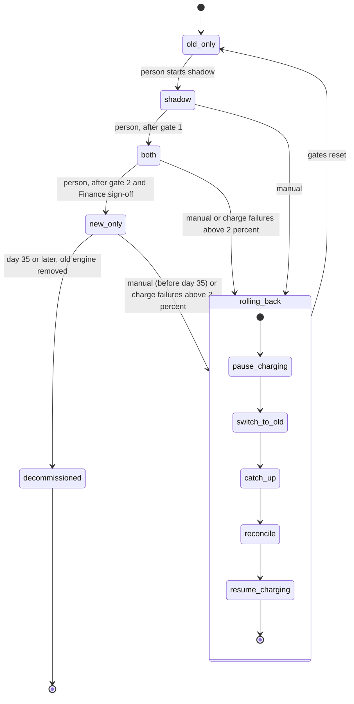

# Billing engine rollout

Today, billing workers run the old engine. It reads usage events from the usage event log (kept 35 days), computes invoices, writes them to the billing ledger (the system of record) and charges customers through the payment provider. We are replacing it with a new engine in four modes, moved one step at a time by a person. Any time something looks wrong, a rollback returns everything to the old engine without charging anyone twice or dropping a charge that is due. The 35-day log limit is what makes the final step irreversible.

## Terms

- `billing_mode`: the one global flag in the config service. Its value is the current state: `old_only`, `shadow`, `both` or `new_only`.
- Shadow store: a separate store for invoices that must not be charged or written to the ledger.
- Nightly comparison job: compares the two engines' invoices per customer and saves the results in `comparison_results`. A mismatch is an invoice total that differs by more than one cent.
- Billing monitor: watches the new engine's charge failure rate and starts a rollback when the rate is too high.
- Rollout tool: how a person moves the flag forward, starts a rollback by hand, or records Finance sign-off.
- Rollback record: a record of which rollback step is running and which are done, so a retry resumes where it stopped.
- Billing period: the span an invoice covers. A customer is charged once per period.

## Modes

| Mode | Old engine | New engine |
|---|---|---|
| `old_only` | Computes, writes the ledger, charges. | Off. |
| `shadow` | Computes, writes the ledger, charges. | Reads the same usage events and writes invoices to the shadow store only. It never charges and never writes the ledger. |
| `both` | Computes every invoice into the shadow store, so it stays current. It does not charge. | Writes the ledger and charges. |
| `new_only` | Stops computing. | Does everything. |

## Diagram

Moves forward are one step at a time, never skipping, and always by a person. Rollback always ends in `old_only`.

## Gates and triggers

- Gate 1, `shadow` to `both`: 7 consecutive days with a mismatch rate under 0.1%, and at least 5,000 invoices compared.
- Gate 2, `both` to `new_only`: 14 days in `both` with no unresolved mismatches, plus Finance sign-off.
- Manual rollback: on-call can start it at any time from `shadow`, `both` or `new_only`, up to day 35 in `new_only`. After that the usage events the old engine would need are gone, so there is no way back.
- Automatic rollback: the billing monitor starts it in `both` or `new_only` when the new engine's charge failure rate is above 2% over any 10-minute window. New-engine errors in `shadow` are recorded but never trigger a rollback, because the new engine charges nothing there.
- After any rollback the gates reset. The rollout must pass through `shadow` again, and the 7-day count starts over.
- Decommissioning: the old engine may be removed after 35 days in `new_only` without a rollback. From that day on there is no rollback.

## Rollback steps

A rollback starts when the monitor or on-call asks the rollout tool. Each step is recorded in the rollback record when it finishes. Steps are safe to repeat, and a failed step is retried. Steps that do not apply are skipped.

1. `pause_charging`: both engines stop charging, so nothing can be charged twice while the mode changes. If this fails, retry. Nothing has changed yet.
2. `switch_to_old`: set `billing_mode` to `old_only`. If this fails, retry. Charging stays paused.
3. `catch_up`: only from `new_only`. The old engine reprocesses the usage events it skipped while the new engine was in charge. From `shadow` or `both` the old engine is already current, so skip it. If it fails, retry. Charging stays paused, so charges are late but not lost.
4. `reconcile`: for each customer and billing period, check the ledger. Charge periods that are due and have no charge recorded. Never charge a period that already has one. If it fails, retry.
5. `resume_charging`: the old engine charges again. If this fails, retry.

If a step keeps failing, on-call is paged and charging stays paused. Pausing is the safe state, because it delays charges but never doubles or drops one.

## Where state lives

- Current mode: `billing_mode` in the config service.
- Gate evidence: `comparison_results`, written by the nightly job.
- Invoices: the ledger for the engine that is charging, the shadow store for the other.
- Rollback progress: the rollback record.

## What happens when things fail

| Failure | Handling |
|---|---|
| New-engine errors in `shadow` | Recorded only. No rollback. |
| Charge failure rate above 2% in 10 minutes, in `both` or `new_only` | Automatic rollback. |
| Rollback step fails | Retry the step. If it keeps failing, page on-call and keep charging paused. |
| Nightly comparison job fails | No result for that day. The day does not count toward a gate. |
| Rollback wanted after day 35 in `new_only` | Not possible. |

## Open questions

- Is the 5,000-invoice minimum for each day or for the 7 days together?
- Where the rollback record is stored is not decided.
- How reconcile identifies a charge already made, for example whether the payment provider accepts a customer-and-period key to block duplicates, is not confirmed.
- Whether a failed comparison job breaks the "consecutive" run of 7 days is not decided. The table above counts it as a missed day.
- Whether paging on-call is the right escalation is assumed, not given in the brief.
