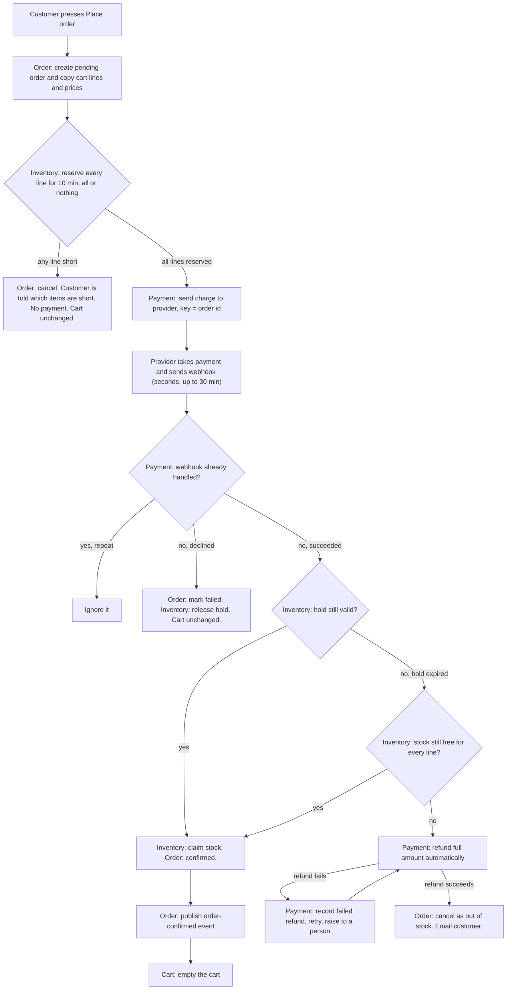

# Checkout across Cart, Inventory, Payment and Order

Checkout moves out of the monolith into four services: Cart, Inventory, Payment and Order. Each service owns its own database, and no service reads another's tables. Checkout starts when the customer presses Place order. Stock is held first, then the customer is charged, and the order is confirmed only if the held stock is still claimed. If the payment succeeds after the hold has expired and the stock is gone, the money is refunded and the order is cancelled. The design keeps money from moving before stock is held, and never keeps money for an order that cannot be filled.

## Terms

- **Service**: a separate program with its own database. Other services ask it for data over HTTP or listen to its events. They never read its tables.
- **HTTP call**: one service asks another service a question or asks it to do something, and waits for the answer.
- **Message broker**: a shared channel where services publish events and other services receive them.
- **Event**: a message that says something happened, for example "order confirmed".
- **Payment provider**: the outside company that actually takes the customer's money.
- **Webhook**: a message the payment provider sends to us to report the result of a payment. It can arrive late, and it can arrive more than once.
- **Idempotency key**: a unique value sent with a charge request. The provider treats a repeated request with the same key as the same charge, so a retry cannot charge twice. Here the key is the order id.
- **Reservation (hold)**: stock set aside for one order for 10 minutes. It expires unless the order claims it.
- **Claim**: turning a hold into a sale, so the stock belongs to the order.
- **Refund**: money the provider sends back to the customer.
- **Snapshot**: a copy of the cart lines and prices, taken at the moment of Place order.

## Diagram

## Steps

Each step says what starts it, what happens, and what each service keeps.

1. **Place order (Order service).** The customer presses Place order. The Order service creates the order as pending. It asks the Cart service over HTTP for the cart lines and prices, and stores a snapshot of them in its own database. Later cart edits and price changes do not change the order. The Cart service keeps the live cart. If the cart cannot be read, checkout stops and the cart is unchanged.

2. **Reserve stock (Inventory service).** The Order service asks Inventory over HTTP to reserve every line. Inventory reserves all lines or none. It stores each hold, with its expiry time 10 minutes away, in its database. If any line is short, nothing is reserved and no payment is requested. The Order service marks the order cancelled and tells the customer which items are short. The cart is unchanged.

3. **Take payment (Payment service).** This runs only after every line is reserved. The Order service asks Payment to charge the order. Payment sends the charge to the provider with the order id as the idempotency key, and records the attempt in its database. If the call fails or times out, Payment retries with the same key. The customer is charged at most once. Only the Payment service talks to the provider.

4. **Receive the outcome (Payment service).** The provider sends a webhook with succeeded or declined. This usually takes seconds but can take up to 30 minutes. Webhooks can arrive more than once. Payment checks its database for whether it has already handled this webhook. A repeat is ignored. A new webhook is stored as handled, then processed.

5. **Declined.** Payment records the decline. The Order service marks the order failed. The Inventory service releases the hold, so the stock goes back on sale. The cart is unchanged.

6. **Succeeded, hold still valid.** The Order service asks Inventory to claim the stock. Inventory turns the hold into a sale. The Order service marks the order confirmed and publishes an order-confirmed event on the message broker. The Cart service receives the event and empties the cart. The cart is emptied only at this point.

7. **Succeeded, hold expired.** The stock may have been sold to someone else. Inventory checks whether the stock is still free for every line. If it is, Inventory reserves and claims it, and the flow continues at step 6. If any line is gone, Payment refunds the full amount automatically. No partial order is shipped. Then the Order service cancels the order as out of stock and emails the customer. The cart is unchanged.

8. **Refund fails.** A refund can fail at the provider. Payment records the failed refund and retries it. The refund is raised to a person. It must never be dropped silently.

## Rules across all steps

- Each service has its own database. No service reads another's tables.
- Services talk over HTTP or through events on the message broker.
- Stock is reserved before any payment is requested.
- Reservation is all or nothing.
- The order records cart lines and prices only at Place order time.
- Only the Payment service talks to the payment provider.
- Every charge carries the order id as its idempotency key.
- A repeated webhook is never processed twice.
- Refunds are never silently dropped.
- The cart is emptied only after the order is confirmed. If checkout fails for any reason, the cart stays exactly as it was.

## What happens when things fail

| Failure | What happens | Cart | Money |
|---|---|---|---|
| A line is short | Nothing reserved. No payment. Customer told which items are short. | Unchanged | None taken |
| Charge request fails or times out | Payment retries with the same order id key. | Unchanged | At most one charge |
| Payment declined | Order marked failed. Hold released. | Unchanged | None taken |
| Success after hold expired, stock still free | Stock reserved and claimed again. Order confirmed. | Emptied on confirmation | Kept for the order |
| Success after hold expired, stock sold | Full refund. Order cancelled as out of stock. Customer emailed. | Unchanged | Refunded |
| Refund fails at provider | Recorded, retried, and raised to a person. | Unchanged | Refund pending until it succeeds |
| Repeated webhook | Ignored. | Unchanged | No change |

## Open questions

- If the order-confirmed event is lost or late, the cart is not emptied. How this is recovered is not decided.
- How a repeated webhook is recognised is not decided. The provider's event id is one option.
- The retry limit for refunds, and how a person is alerted, are not set.
- The exact order status names (for example pending, confirmed, failed, cancelled) are not fixed.
- The first draft allowed re-reserving stock when the hold has expired. The brief says to refund and cancel. This document keeps the re-reserve path only when the stock is still free. Confirm this is wanted.