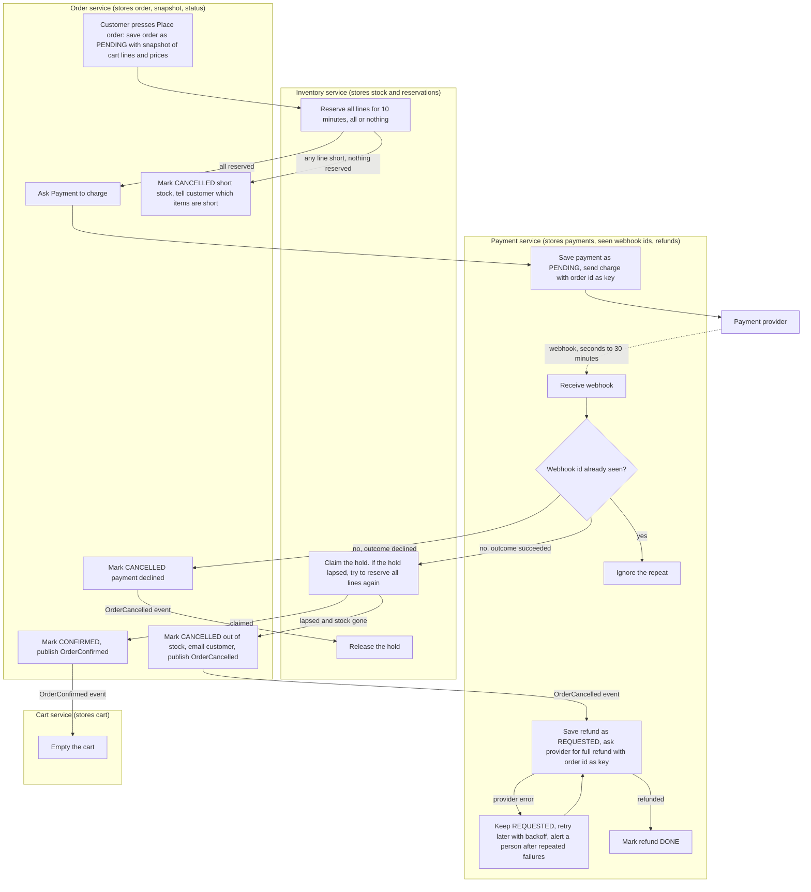

## Checkout plan

Checkout moves out of the monolith into four services that exist as stubs: Cart, Inventory, Payment and Order. When the customer presses Place order, Order saves a copy of the cart, Inventory holds the stock, Payment charges the customer, and then Order confirms the order and Cart empties. Stock is held before any payment is requested so we never charge for goods we cannot supply. Because the payment result can arrive up to 30 minutes later, the stock may be gone by then, and the plan refunds in that case.

### Rules that apply to every step

- Each service owns its own database. No service reads another's tables. Services talk over HTTP or through events on the shared message broker.
- Only Payment talks to the payment provider.
- Every charge request carries the order id as its idempotency key.
- We never ship partial orders and never keep money for an order we cannot fulfil.
- If checkout fails for any reason, the cart stays exactly as it was so the customer can try again.

### Terms

- **Order snapshot**: the cart's lines and prices as they were at Place order, stored on the order. Later cart edits or price changes do not touch it.
- **Reservation (hold)**: stock set aside for one order for 10 minutes. If the order has not claimed it by then, the stock goes back on sale.
- **Claim**: turning a hold into a sale once payment has succeeded.
- **Idempotency key**: a value sent with a request so the provider treats a retry as the same request. Here it is the order id, so a retry can never charge twice.
- **Webhook**: a call the provider makes to us to report the payment result (succeeded or declined). It usually takes seconds, can take up to 30 minutes, and may be delivered more than once.
- **Event**: a message on the shared broker. Other services react to it on their own.

### Diagram

### Notes on the steps

1. **Place order** (starts when the customer presses the button). Order saves the snapshot and status PENDING. Cart is not changed. Order then calls Inventory by HTTP.
2. **Reserve** (Inventory). Either every line is held or nothing is. If any line is short, Inventory replies with the short items, Order cancels and shows them to the customer, and no payment is requested.
3. **Charge** (Order calls Payment by HTTP, Payment calls the provider). Payment saves the payment before calling. If the call fails or times out, Payment retries with the same key, so the customer is never charged twice.
4. **Webhook** (starts when the provider calls Payment). Payment checks the webhook id against the ids it has already stored. A repeat is ignored. A new one is stored, then Payment publishes a PaymentSucceeded or PaymentDeclined event, which Order reacts to.
5. **Declined.** Order cancels. The OrderCancelled event tells Inventory to release the hold. If the hold has already lapsed there is nothing to release.
6. **Succeeded.** Order asks Inventory to claim the hold. If the hold has lapsed, Inventory tries to reserve all lines again, all or nothing. If that works, the claim succeeds. If it does not, the stock was sold to someone else.
7. **Confirmed.** Order marks the order CONFIRMED and publishes OrderConfirmed. Cart empties itself on that event, and only then.
8. **Out of stock after payment.** Order marks the order cancelled as out of stock, emails the customer and publishes OrderCancelled. Payment reacts by refunding the full amount. A refund is stored before it is sent and is only marked DONE when the provider confirms, so a failed refund stays on file and is retried until it succeeds. It is never dropped.

### What happens when things fail

| Failure | Result |
|---|---|
| A line is short | Nothing reserved, no payment requested, customer told which items are short, cart unchanged |
| Charge request fails or times out | Retried with the same order id key, so no double charge |
| Provider declines | Order cancelled, hold released, cart unchanged, customer can try again |
| Duplicate webhook | Ignored, nothing is processed twice |
| Payment succeeds after the hold lapsed, stock still free | Stock reserved again, order confirmed |
| Payment succeeds after the hold lapsed, stock gone | Full refund, order cancelled as out of stock, customer emailed |
| Refund fails at provider | Stays REQUESTED, retried with backoff, a person is alerted after repeated failures |
| Any failure before confirmation | Cart stays exactly as it was |

### Build order

The four stubs already exist. Build Order and Inventory first (steps 1, 2, 6), then Payment with webhook deduplication (steps 3, 4), then refunds (step 8), and last the Cart event handler (step 7). Test the late-success and failed-refund branches before turning the flow on.

### Open questions

- If no webhook arrives within 30 minutes, the plan does not yet say what happens. A simple option is for Payment to ask the provider for the payment's status, but this is not decided.
- Which service sends the customer emails (Order directly, or a shared notification service) is not decided.
- How many failed refund retries trigger the alert, and who is alerted, is not decided.