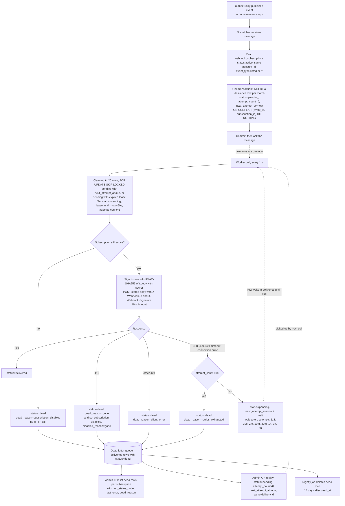

# Webhook delivery service

**Components**
- **Dispatcher**: consumes `domain-events` (published by the existing outbox relay) and turns each event into delivery rows.
- **`deliveries` table**, in the service's own Postgres. All delivery state is stored here and nowhere else. Each (event, subscription) pair has one row, unique on `(event_id, subscription_id)`. Columns: `id` (the delivery id, sent as `X-Webhook-Id`), `event_id`, `subscription_id`, `body` (the exact JSON bytes to send), `status` (`pending`, `sending`, `delivered`, `dead`), `attempt_count`, `next_attempt_at`, `lease_until`, `last_status_code`, `last_error`, `dead_reason`, `dead_at`.
- **Delivery workers**: any number of instances. They poll `deliveries` directly and do not use the queue.
- **Admin API** and a **nightly cleanup job** work on the dead rows.

The queue is used only for intake. It cannot delay a message by more than 15 minutes, and its dead-letter topic cannot be queried. So retries wait as rows in `deliveries`, and the dead-letter queue is just the rows with `status = dead`.

**Failure and recovery**
- **Dispatcher crashes before acking**: the queue redelivers the message after its visibility timeout. The re-insert hits the unique key and does nothing. Relay duplicates are absorbed the same way. An event that matches no subscription is acked and stores nothing.
- **Worker crashes mid-attempt**: the row stays `sending`. When `lease_until` passes (claim time + 60 s, longer than the 10 s HTTP timeout), the next poll by any worker reclaims the row. `attempt_count` was raised at claim time, so the lost attempt counts toward the 8. The receiver may see the request twice and dedupes on `X-Webhook-Id`.
- **Late worker**: a worker writes its outcome only if `attempt_count` still equals the value it claimed, so it cannot overwrite a newer attempt.
- **Signing**: the dispatcher stores the body bytes once. On every attempt, replays included, the worker decrypts the subscription's secret, takes a fresh `t` and recomputes `v1`. A late retry or replay therefore still passes the receiver's 5-minute check.
- **Subscription disabled** (by a 410 or by the customer): the dispatcher matches only active subscriptions. Rows already waiting are dead-lettered with `subscription_disabled` at their next claim, without an HTTP call. The admin API refuses (409) to replay into a disabled subscription.
- **Ordering**: none. Each delivery retries on its own schedule, so a subscriber can get a later event before an earlier one.
- **Retention**: the nightly job deletes `dead` rows 14 days after `dead_at`, and `delivered` rows after 7 days.

## General considerations

This design follows common good practice. Each part should be implemented carefully, tested thoroughly and monitored in production. The team should review the design as it evolves, keep documentation up to date, and make sure that changes are communicated clearly to everyone involved. Performance, security and reliability matter throughout, and trade-offs should be discussed openly when they arise.
