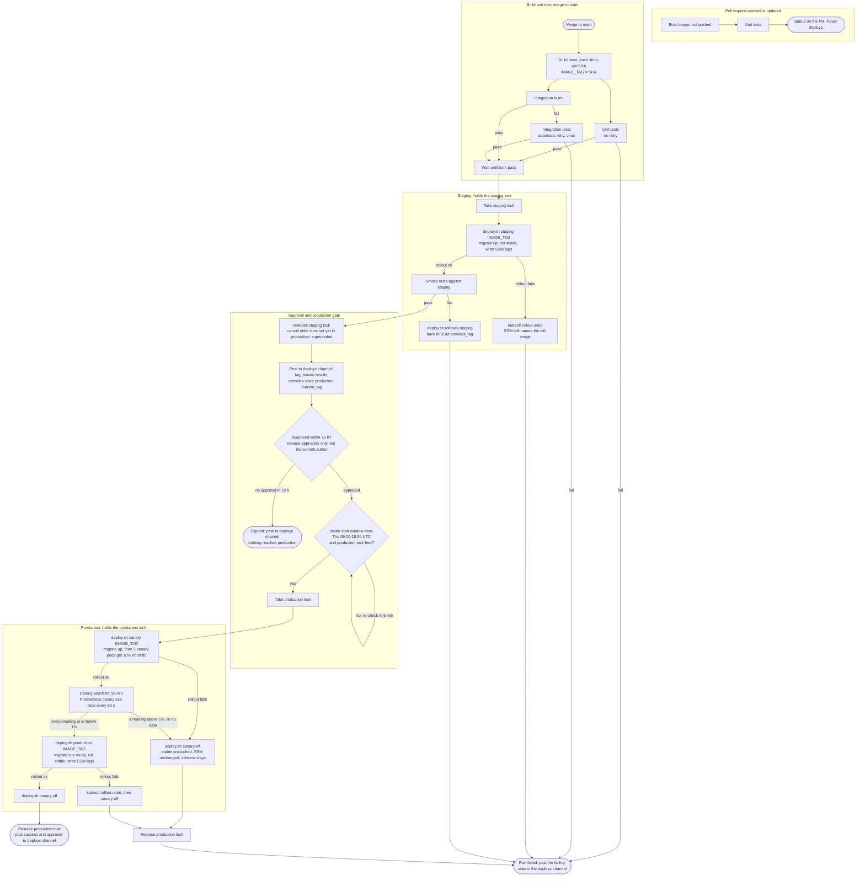

# shop-api release pipeline

**What starts a run.** A pull request runs build and unit tests only and never deploys. A merge to `main` starts the full pipeline below.

**Where state lives**
- **Image.** Built once per run and pushed as `registry.internal/shop-api:<commit SHA>`. The tag becomes the run output `IMAGE_TAG`, which every later job reads. Staging and production deploy exactly this image. Nothing is rebuilt.
- **What each environment runs.** This is kept in SSM Parameter Store, outside the pipeline, under `/deploy/<env>/current_tag` and `/deploy/<env>/previous_tag`. Only `deploy.sh` writes them: `deploy.sh <env> <tag>` after a successful stable rollout, and `deploy.sh rollback <env>` when it sets current_tag back to previous_tag. The canary is never recorded.
- **Schema.** Migrations are forward-only. `deploy.sh` runs `migrate up` before the new image starts, and nothing reverts it, so every rollback swaps the image only. Each migration must work with the previous image.
- **Approval.** The CI run record keeps who approved and when.
- **Locks.** There are two CI named locks, `staging` and `production`. Each is held by one run at a time.

**Step notes**

1. **Tests.** Unit and integration tests start together after the build. Integration tests get one automatic retry. Unit tests get none. Any final failure ends the run, and nothing reaches staging.
2. **Staging.** The run holds the `staging` lock from the deploy until the smoke result, pass or fail. `deploy.sh staging IMAGE_TAG` migrates, rolls the stable deployment and writes the SSM tags.
   - If the rollout fails, `kubectl rollout undo` returns staging to the pods that were running. SSM was not written, so it still names them. `rollback` is not used here because previous_tag would go one version too far back.
   - If the smoke tests fail, `deploy.sh rollback staging` restores previous_tag, which is the image staging ran before this run.
3. **Supersede.** When a run passes the staging smoke tests, every older run that has not started its production deploy is cancelled as *superseded* and posts a notice. That includes runs waiting for approval, for the window or for the lock. Approvers only ever see the newest build verified on staging.
4. **Approval.** The run posts to #deploys with IMAGE_TAG, a link to the smoke results, and the commits between production `current_tag` and IMAGE_TAG. A `release-approvers` member who is not the commit author approves in the CI UI. The 72-hour clock starts when the run reaches the gate. If it runs out, the run ends as *expired*: nothing goes to production, and staging keeps the image.
5. **Production gate.** An approved run starts only when two things are true: the time is inside the start window (Mon-Thu 09:00-15:00 UTC), and the `production` lock is free. Otherwise it waits and re-checks every 5 minutes, so an approval given on Thursday evening starts at Monday 09:00. A given approval does not expire. Once started, the deploy may run past 15:00.
6. **Canary.** `deploy.sh canary IMAGE_TAG` runs the migrations, then puts 2 canary pods on the new image. Those pods take 10% of traffic. The canary-watch step queries Prometheus for the canary's 5xx ratio every 60 seconds for 15 minutes. One reading above 1%, or a query with no data, fails it at once and triggers `deploy.sh canary-off`. The stable deployment was never touched, SSM is unchanged, and the schema stays migrated.
7. **Stable.** `deploy.sh production IMAGE_TAG` rolls stable and writes SSM. The migrate step is a no-op by now. If the rollout fails, the pipeline runs `kubectl rollout undo` and then `canary-off`. On success it runs `canary-off`, releases the lock and posts to #deploys with the approver's name.
8. **Notices.** All of these go to #deploys: waiting for approval, superseded, expired, failed (with the failing step), and production done.

## General considerations

This design follows common good practice. Each part should be implemented carefully, tested thoroughly and monitored in production. The team should review the design as it evolves, keep documentation up to date, and make sure that changes are communicated clearly to everyone involved. Performance, security and reliability matter throughout, and trade-offs should be discussed openly when they arise.
