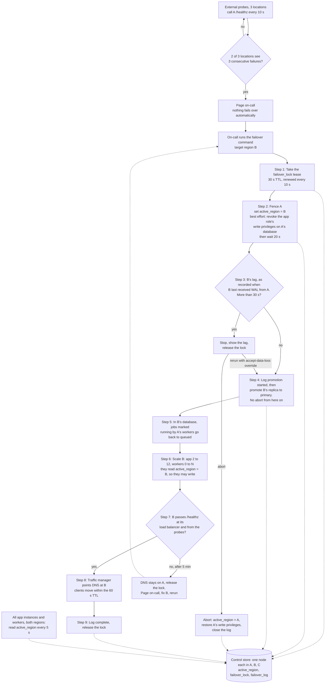

# Failover: Region A to Region B

**Where state lives**

- **Control store.** A 3-node strongly consistent key-value cluster with one node in each of A, B and a third region, C. Every read and write needs a majority (2 of 3 nodes), so a region cut off from the other two can neither read it nor change it. It holds `active_region` (A or B), `failover_lock` and `failover_log`. Only the failover command (including its abort) writes to it.
- **Database.** A's Postgres streams WAL to B's replica asynchronously. Each time B receives WAL, it records how far its replay trails A. All app data, including the `jobs` table, moves with the database.
- **Sessions.** Redis in each region, not replicated.

**Self-fencing rule (every app instance and worker, in both regions).** Read `active_region` from the control store every 5 s. Start a database write only if a successful read within the last 15 s (timed from when the read was sent) named your own region. Write transactions are capped at 5 s. Otherwise be read-only: serve reads, answer writes with 503 "read-only, retry shortly", and stop claiming jobs (workers). So a region has stopped committing within 20 s of `active_region` naming the other region, or of losing the control store. This rule is what fences a partitioned A that we cannot reach; the privilege revoke in step 2 is only a backstop for when we can. The cost: if A loses contact with both B and C, it goes read-only even when no failover is running.

**What starts each step.** The command runs the steps in order, and each starts when the one before it is logged done. Between steps 2 and 4 nothing can write: A is fenced and B's database is still a read-only replica. Step 3 runs after the fence wait, when A can no longer send WAL, so B's recorded lag is final. If step 3 stops the run, on-call decides promptly, because nothing can write until they rerun with the override or abort. Step 7 polls B's health for up to 5 min. Whenever the command stops on purpose (lag over 30 s, or B unhealthy), it releases the lock and the log keeps its place.

**Interrupted runs.** Each step writes "started" to `failover_log` before it begins and "done" when it finishes. `failover_lock` is a lease with a 30 s TTL that the running command renews every 10 s; a command that cannot renew it stops before starting another step. If a run crashes, its lease runs out within 30 s. Every run, first or rerun, takes the lock and then resumes at the first step not logged done. A step that was started but not finished is repeated. Every step is safe to repeat: an already promoted database, already requeued jobs, an already scaled region and an already switched DNS record are left as they are.

**Abort.** Until step 4 is logged as started, on-call can run `failover --abort`. It takes the lock, sets `active_region` back to A, restores the write privileges of the app's role on A's database if step 2 revoked them, and closes the log so a later failover starts from step 1. A's running instances resume writes on their next successful read, within 5 s. Once step 4 is logged as started, abort is refused, even if the run crashed partway through promotion, and the command only goes forward. There is no return to A during this incident.

**Requests still reaching A.** From step 2 until a client's cached DNS expires (up to 60 s after step 8), its requests still go to A. The fence leaves A's instances running, so if A is up they are self-fenced: reads come from A's stale database and writes get a 503. If A is down, those requests fail. After the TTL expires, clients reach B.

**Data loss.** B replays all the WAL it received before it is promoted, so what is lost is what A committed that B never received (replication is asynchronous). If A failed outright, that is no more than B's recorded lag, which step 3 holds to 30 s unless on-call uses the override. If A kept running after B stopped receiving from it (a partition rather than a crash), A's commits from then until it stopped writing, at the latest 20 s after step 2, are missing from B as well. Step 3 cannot see those. They survive only in A's old database, which is why it is snapshotted when A comes back.

**Background jobs.** Step 5 runs before any B worker starts, so every row marked `running` was claimed by A's workers. Step 5 sets them back to `queued`, and B's workers rerun them once step 6 starts them. Jobs that A finished in its last unreplicated seconds also rerun. Every job must be idempotent (keyed by job id), so a rerun is safe.

**Sessions.** B's Redis holds no sessions from A, so every user signs in again (accepted).

**After A recovers.** No automatic failback. A's app stays read-only because `active_region` = B. A's old database is snapshotted so the lost writes can be reviewed, then wiped and rebuilt from a base backup of B as B's replica. Moving back to A is a separate, planned switchover.

**RTO check (15 min, from step 1).** Taking the lock takes seconds (up to 30 s more after a crashed run), the fence wait is 20 s, the lag check seconds, promotion about 1 min, scale-up and health checks about 5 min, and DNS 60 s. That is about 8 min in total.

## General considerations

This design follows common good practice. Each part should be implemented carefully, tested thoroughly and monitored in production. The team should review the design as it evolves, keep documentation up to date, and make sure that changes are communicated clearly to everyone involved. Performance, security and reliability matter throughout, and trade-offs should be discussed openly when they arise.
